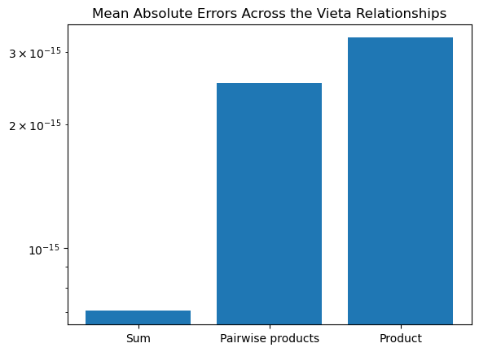
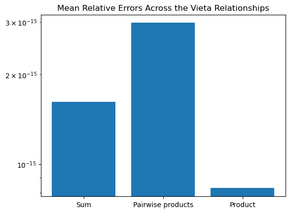
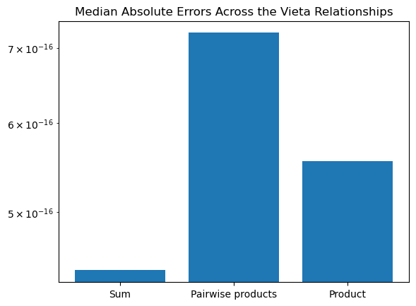
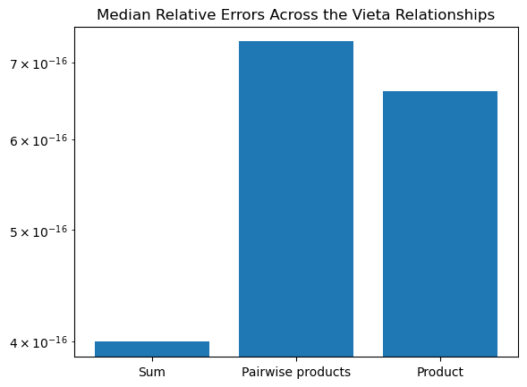

# Vieta's Formulas

## Overview

Vieta's formulas are relationships named for François Viète which relate the coefficients of a polynomial to the sums and products of its roots ([Wikipedia](https://en.wikipedia.org/wiki/Vieta's_formulas)). I'd learned them while self-studying the Cambridge AS/A Levels course Further Mathematics (9231), was curious about how they worked, and wanted to visualise them. I did not quite have a full plan for this project when I began it; I simply extended it as I went. First, I visualised the relationships, and when I found that there were small numerical errors, I was curious on how those errors would change with the coefficients. So, I started by computing multiple polynomials with various coefficients and computing the errors. At the end, I generated 1000 cubics and computed the errors for those. Then, I analysed the results with my limited knowledge on computational mathematics, and kept my thoughts honest and my own. I dare say I'll enjoy looking back on this when I learn more math and coding and so can properly explain the phenomenon I've explored here.

## Mathematics

For a cubic polynomial equation with roots $r_1,r_2,r_3$, 
$$
ax^3 + bx^2 + cx + d = 0
$$ 
The roots can be related with the sums and products by the following formulas:
$$r_1 + r_2 + r_3 = -\frac{b}{a}$$
$$r_1r_2 + r_1r_3 + r_2r_3 = \frac{c}{a}$$
$$r_1r_2r_3 = -\frac{d}{a}$$
I computed these sums and products algorithmically, then compared them with the expected values as given by the formulas to find the errors in the numerical computation.

## Methodology

I used pandas for the data analysis, NumPy for the calculations, and Matplotlib to visualise the data. The coefficients were generated randomly using NumPy. I did not use a particular seed, but the generated polynomials can be viewed in the vieta_dataset.csv file. The roots were calculated using NumPy's polynomial root-finding functionality (''Polynomial.roots()''), and used them to calculate each relationship. These were the observed values. I compared the observed and expected values by calculating absolute errors:
$$E_{\text{sum}} = \left| (r_1+r_2+r_3) - \left(-\frac{b}{a}\right) \right|$$
$$E_{\text{pairs}} = \left| (r_1r_2+r_1r_3+r_2r_3) - \frac{c}{a} \right|$$
$$E_{\text{product}} = \left| r_1r_2r_3 - \left(-\frac{d}{a}\right) \right|$$
As well as relative errors:
$$E_{\text{relative}} = \frac{|x_{\text{computed}}-x_{\text{expected}}|}{|x_{\text{expected}}|}$$
I did note that relative error becomes undefined when the expected value is zero, so I set $1 \times 10^{-6}$ as the minimum threshold for the denominator. If the absolute value of the expected Vieta value (say, b/a, when calculating the sum of roots' relative error) was lower than the threshold, the relative error value would be omitted, though no such values occurred.
Lastly, I plotted the data logarithmically $\left(\log_{10}(\bar{E}) \text{ and } \log_{10}(E_{\mathrm{median}})\right)$ for easier comparison.

## Results

### 1. Summary Statistics

The following table summarises the absolute errors observed across the 1000 randomly generated cubic polynomials.

| Error Type | Mean | Median | Maximum | Standard Deviation |
|---|---|---|---|---|
| Sum | 7.038798797293077e-16 | 4.440892098500626e-16 | 5.684341886080803e-14 | 1.942759610588618e-15 |
| Pairwise Products | 2.5211985277273642e-15 | 7.2164496600635185e-16 | 5.684341886080801e-13 | 2.026806682208766e-14 |
| Product | 3.2484800298615114e-15 | 5.551115123125784e-16 | 7.958078640513122e-13 | 2.896762757328179e-14 |

### 2. Visualisations and Hypotheses

From these two graphs and my preliminary results, I had theorised that the mean absolute error was due to the fact that sums are (generally) larger than pairs, which are generally larger than products. I theorised then for relative errors that multiplication may be more accurate/produce a smaller computational error than summation.

When I produced these graphs, I was interested to see that the errors had the same relationship in terms of size. I then theorised that the errors come from the number of operations performed (sum and product being two, and pairwise products being five), as well as the fact that products are generally larger than sums (to explain why the product's error is greater than that of the sum)

### 3. Limitations

We must consider the fact that these results do not represent all cubics since my coefficients only fall within the range $[-100, 100]$. The sample size (1000) is also not particularly large. We also cannot generalise these results to other polynomials. I also did not consider any "categories" of cubics, for example, I did not separate out those with three real roots or one real root and two complex roots. Do note that I have very little knowledge on computational mathematics, so my conclusions based on the data are no more than guesses.

### 4. Conclusion

To conclude, no matter the relative sizes, these errors are all still extremely small. It is very interesting to me to see proof of how accurate our computers are, to the order of magnitude of the diameter of nucleons, as compared to the height of humans. I also can say that I have a much clearer understanding of Vieta's formulas now.

